# Design e layout

Riferimento visivo dell'app. Le schermate in [`docs/design/`](design/) usano **dati inventati**
(nessun movimento reale). Il codice della prima versione del design è marcato con il tag git `design-v1`.

## Principi

1. **Inserire è la cosa più importante.** Il `+` è al centro della barra in basso, sempre a un tocco.
   Il questionario segue l'ordine del Google Form: data → categoria → sottocategoria → importo → note → conto → tag.
   Ogni passo con una scelta avanza da solo al tocco.
2. **In 3 secondi devi capire com'è andata.** La Home apre con un solo numero grande (le spese del mese),
   la barra del budget e la stima di fine mese.
3. **I numeri li calcola il codice.** Grafici e riquadri mostrano valori calcolati in
   `src/lib/analytics/dashboard.ts` (testati), mai stime dell'interfaccia.
4. **Lo stato non è mai solo un colore.** "Superato" e "Oltre l'80%" hanno sempre icona e testo.
5. **Stile iOS.** Sfondo grigio raggruppato, card bianche con raggio 16px, barra in basso traslucida,
   aree di tocco ≥ 44px, testo a 17px (iOS non ingrandisce i campi).

## Struttura

| Area | Contenuto |
|---|---|
| Barra in basso | Home · Movimenti · **+** · Budget · Altro (nascosta durante l'inserimento) |
| Home | Mese (‹ ›) → spese del mese + budget + stima → riquadri Entrate / Investito / Risparmio → avvisi (max 3) → **Giorno per giorno** → budget per categoria → andamento 12 mesi → sottocategorie |
| Giorno per giorno | "Oggi" e quanto puoi spendere al giorno · Ritmo (spese variabili accumulate vs ritmo del budget) · Per giorno (colonne, con/senza fisse) · Settimana (media per giorno della settimana) |
| Movimenti | Ricerca, tipo (segmented), mese, categoria, tag, totali della selezione, raggruppati per giorno |
| Budget | Proposta (media 6 mesi, fisse = mese scorso) e un campo per categoria, barra "Salva" sempre visibile |
| Altro | Impostazioni, export CSV, import, account |
| Impostazioni | Tema (Automatico, Chiaro, Carta, Scuro, Nero) e colore di accento |

## Colori

Definiti come variabili CSS in `src/app/globals.css`; tema su `<html data-theme>` e accento su `data-accent`.

**Serie dei grafici (fisse, non cambiano con l'accento):** primi tre slot della palette validata
(verificata con `validate_palette.js`: separazione per daltonismo ΔE ≥ 9 in chiaro e scuro).

| Serie | Chiaro | Scuro |
|---|---|---|
| Spese | `#2a78d6` | `#3987e5` |
| Investimenti | `#eb6834` | `#d95926` |
| Entrate | `#1baf7a` | `#199e70` |

L'acqua delle entrate è sotto 3:1 sul fondo chiaro: per questo ogni grafico ha legenda, tooltip e tabella dei dati.

**Accenti** (pulsanti, selezioni, barre del budget): tonalità chiara con testo bianco ≥ 5:1, tonalità scura con testo nero ≥ 6:1.

| Accento | Chiaro | Scuro |
|---|---|---|
| Blu | `#2167c4` | `#4a90e8` |
| Viola | `#5b48c9` | `#8f84ec` |
| Verde | `#0b7a55` | `#2fb380` |
| Arancio | `#c0480f` | `#f07a3c` |
| Rosa | `#c0306b` | `#f06a9b` |

**Stati:** buono `#0ca30c`, avviso `#fab219`, critico `#d03b3b`, sempre con icona (✓ ! ✕) e testo.

## Grafici

SVG scritti a mano (`src/components/charts/charts.tsx`), senza librerie:
colonne ≤ 24px con estremità arrotondate a 4px e base squadrata, linee 2px, punti ≥ 8px con anello del colore
di sfondo, griglia sottile e continua, un solo asse Y (mai due scale), legenda con 2+ serie,
tooltip al tocco (un tocco fuori lo chiude), tabella "Mostra i dati in tabella" sotto ogni grafico.

## Schermate

| | | |
|---|---|---|
| 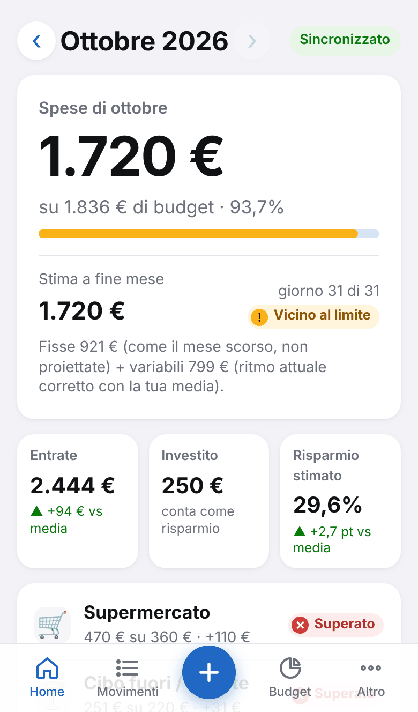 | 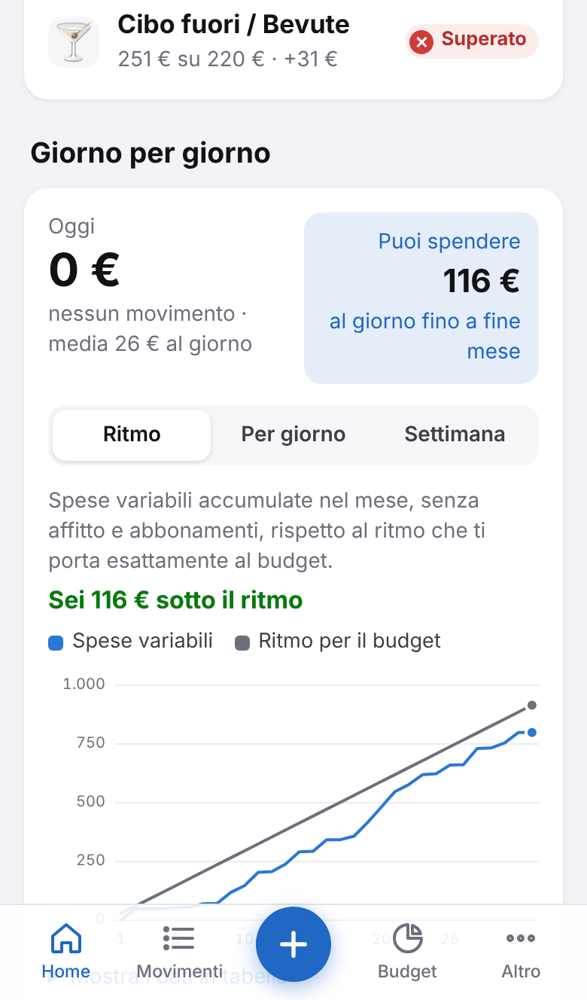 | 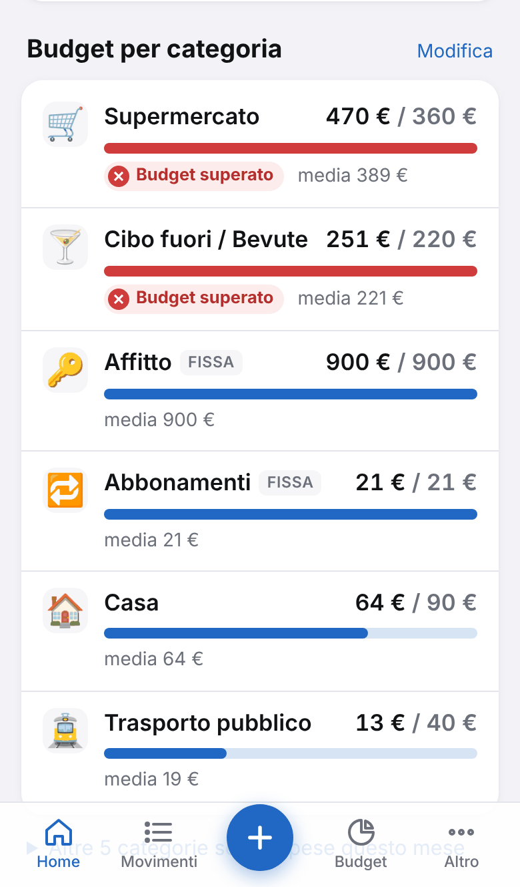 |
| Home | Giorno per giorno | Budget per categoria |
| 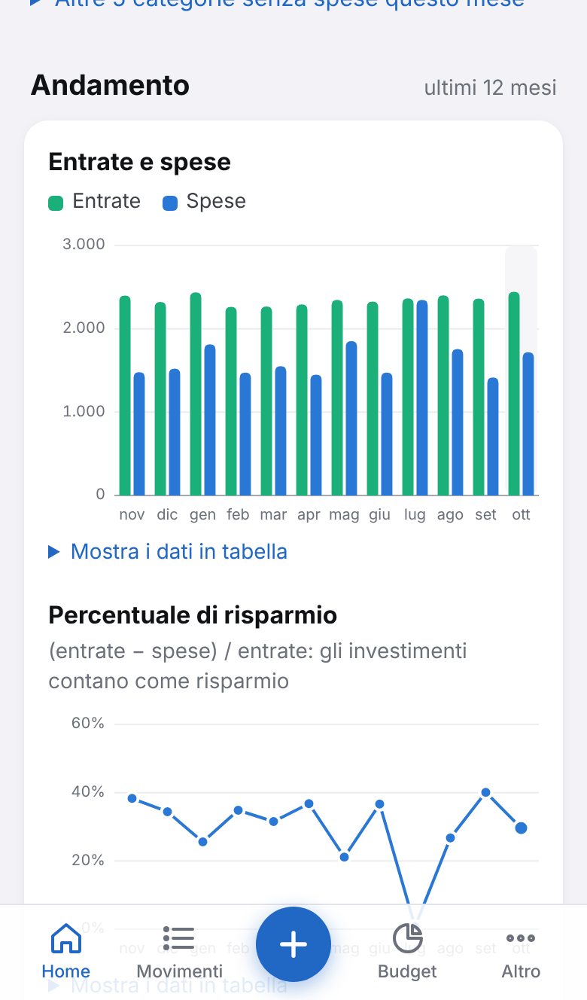 | 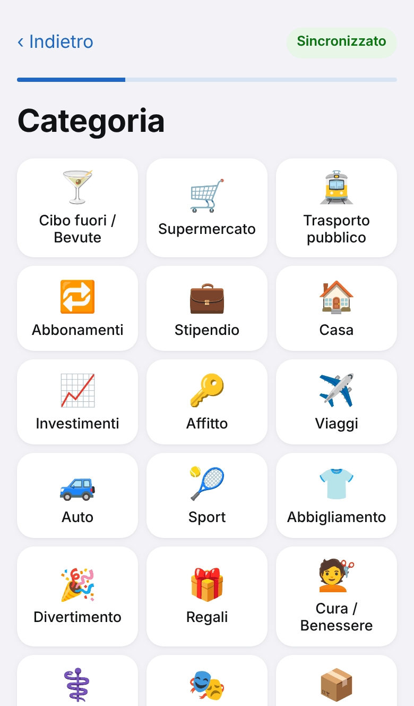 | 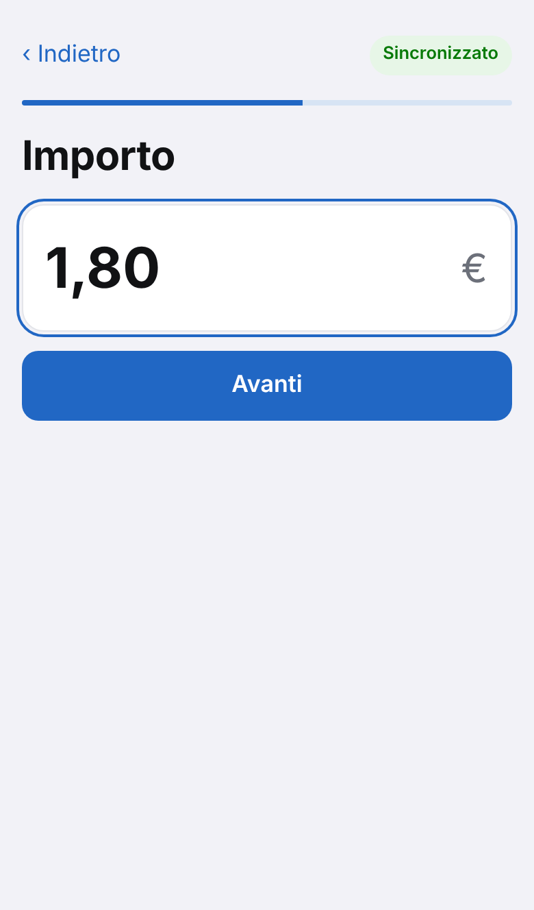 |
| Andamento 12 mesi | Nuovo movimento: categoria | Nuovo movimento: importo |
| 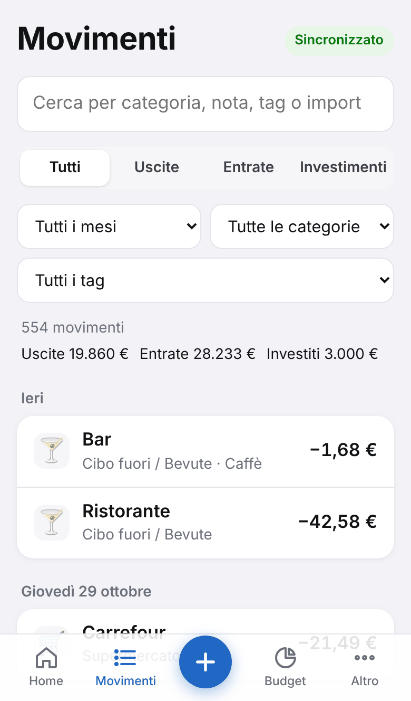 | 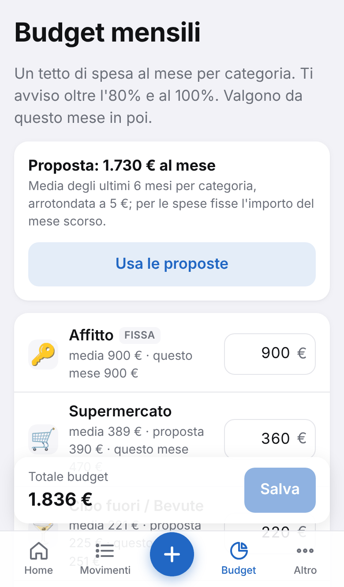 | 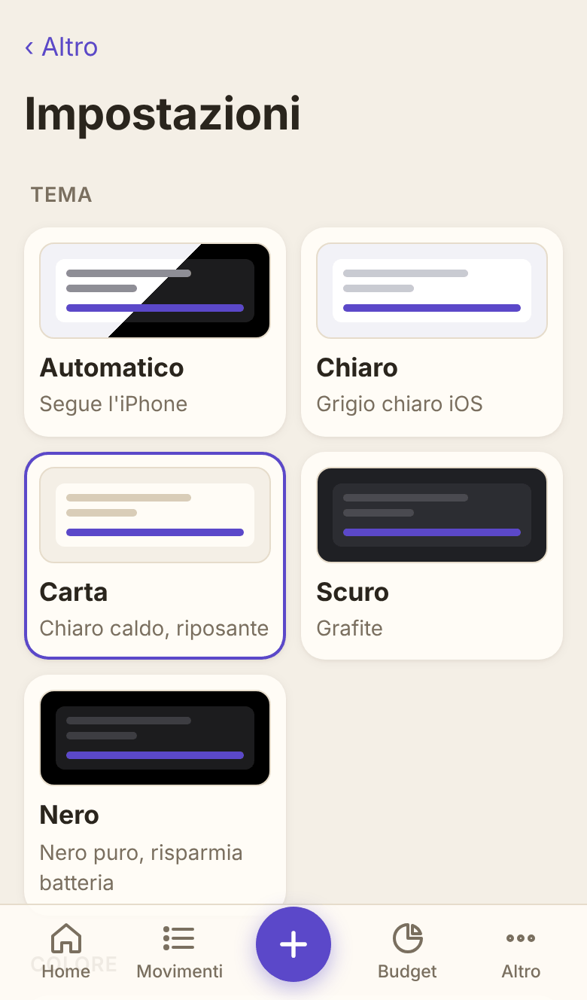 |
| Movimenti con filtri | Budget mensili | Impostazioni (Carta + Viola) |
| 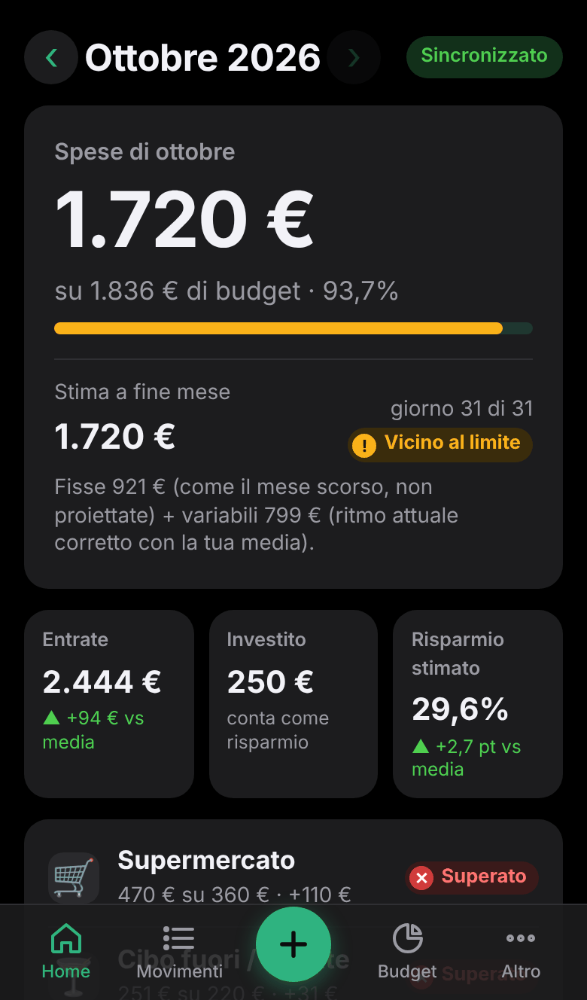 | 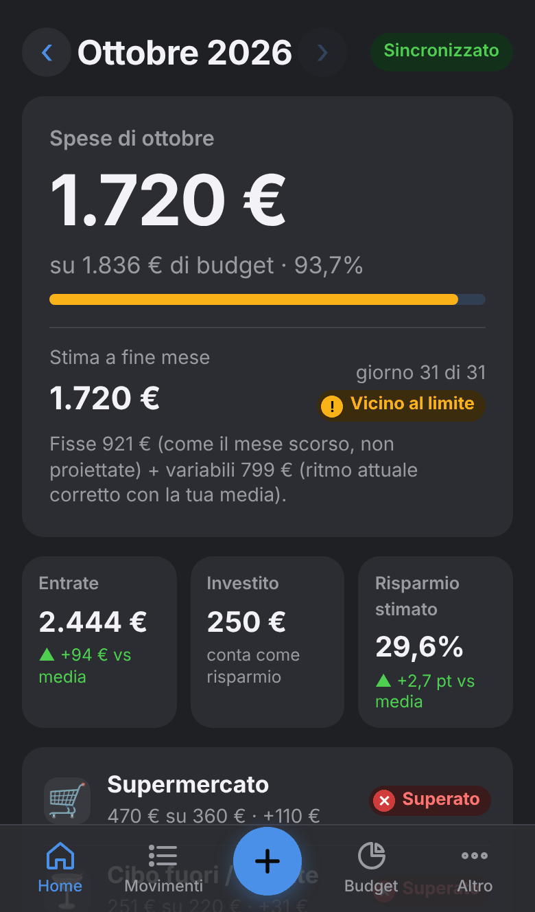 | |
| Home in Nero + Verde | Home in Scuro | |

## Idee da altre app (analisi ottobre 2026)

| Spunto | Da dove | Stato |
|---|---|---|
| Linea del "ritmo di spesa" del mese contro il ritmo ideale per il budget, escludendo le spese ricorrenti che creano picchi | Copilot Money | ✅ Giorno per giorno → Ritmo |
| Barre delle categorie colorate in base al ritmo previsto, non solo allo speso | Copilot Money | ✅ trattino della stima sulle barre |
| Grafico e saldo che si aggiornano subito dopo l'inserimento | Monefy | ✅ conferma "Salvato" + Home aggiornata |
| "Speso oggi" e quanto resta al giorno | widget di molte app di tracciamento | ✅ riquadro Oggi |
| Inserimento in un tocco per le spese ripetute (caffè, biglietto) | Expenses OK, TrackWise | 💡 proposta: "Ripeti" sugli ultimi movimenti |
| Spese ricorrenti riconosciute in automatico | Copilot, Monarch | 💡 proposta (Fase 4) |
| Obiettivi di risparmio con barra di avanzamento | YNAB, Monarch | 💡 proposta |
| Notifica serale con una frase chiara | Copilot | 🔜 Fase 5 |
